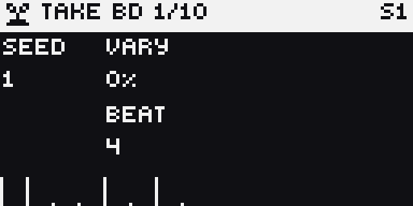
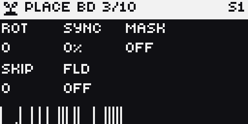

# trig-seedr

[](LICENSE)
[](https://github.com/a1o1/trig-seedr/releases)
[](#status)
[](docs/firmware-notes-os174.md)
[](https://github.com/elekloader/elekloader)
[](lib/)
[](tools/README.md)
[](https://github.com/trigcondition/analog-emu)
[](#grooves)
[](https://www.anthropic.com/claude)
[](https://a1o1.github.io/trig-seedr/)
[](https://conventionalcommits.org)

Pattern seeds for Elektron machines. trig-seedr is a set of offline pattern algorithms, as firmware mods. The first is for the Analog Rytm MKII (OS 1.74), as an [elekloader](https://github.com/elekloader/elekloader) mod; the Analog Four MKII and the Syntakt are planned next. On the Rytm each track has a recipe: a source of trigs (the track's own, or generated), then pages that place them and set velocity, notes, two lanes of parameter locks, trig conditions, retrigs and a groove from Ableton Live, with an audition undo; and rotation of the whole pattern.

<a id="status"></a>**Status: version 0.5 has passed a first test on an Analog Rytm MKII running stock OS 1.74 (2026-11-16): every feature worked as expected; the generate-and-apply rules below came from that test. Every scripted check passes in the emulator (analog-emu).** Flashing modified firmware is at your own risk; keep the stock OS and a way to reflash it (DIN MIDI) at hand.

trig-seedr is an independent project. It is not affiliated with or endorsed by Elektron or Ableton; their product names are used only to say what it works with. No firmware, and nothing derived from Ableton's content, is included: you build against your own copy of the stock OS, and generate groove tables from your own Live installation.

## What it does

It is a third page behind the **TRIG** key: **TRIG** (stock's TRIG page), **TRIG** (EUCLIDEAN), **TRIG** (trig-seedr), **TRIG** again back to stock. **TRIG held + PAGE** opens it from anywhere. **LEFT / RIGHT** step through its pages; **PAGE** and the TRIG keys stay stock's.

| Page | What (0.5) |
|---|---|
| TAKE | SEED, VARY (how much of a take the next seed keeps), PHRS (a phrase of takes over the pages: AAAB, ABAC, …), CVAR (two takes written as alternating trig conditions), METR and BEAT, QUAL (the best of several candidates) |
| RHYTHM | SRC: TRACK (the trigs on the track), RAND (GRID, DENS, BIAS, ROLE: KICK, BACK, HAT, PERC), EUCLID (as stock's Euclidean mode), MAP (a map of drum patterns, credited in the acknowledgements: PART, DENS, X, Y, CHAOS), COPY (another track's trigs) |
| PLACE | ROT, SYNC (anticipation onto the weaker step before), MASK (AVOID or ONLY another track's trigs), SKIP, FLD / FROT / FMOD (rotate one field against the trigs) |
| DYNAMICS | VEL, SHAPE + AMT (STRONG, WEAK, OFF, NOT 1, NOTBAR, RANK, NOISE, EVRY, MAP), ACC with AMOD (RAND or TOP), HUM |
| NOTE | LEN with LMOD (RANGE or LEGATO), NOTE from a RANGE, a LIST (UP, DOWN, PING, PNG2, ODD, RAND) or NOISE |
| LOCK | two lanes of parameter locks, each on a parameter you choose, values from a RANGE, a LIST or NOISE |
| TRIG | trig conditions (X%, A:B, 1ST, FILL, mixed), retrigs (share, rate, velocity curve) |
| TIME | a groove's micro timing and velocity (GRV, TIME, GVEL, QUANT, SHFT), random micro timing (RAND), correlated drift (DRFT) |
| VIEW | the track's steps and the fields of the step under the cursor (read only) |
| TOOLS | ROTATE ALL: every track's whole steps, with their own YES |

Every page but VIEW shows a preview of the take in its bottom strip before YES. Each feature has its own page on
the site and in [`docs/v1/`](docs/v1/).

Screens, from the emulator:

| | |
|---|---|
|  TAKE |  RHYTHM |
|  PLACE |  DYNAMICS |
|  NOTE |  LOCK |
|  TRIG |  TIME |
|  VIEW |  TOOLS |

- **One recipe per track.** A track with trigs starts on SRC = TRACK, an empty one on RAND. A page at 0 (or DEF) leaves its fields alone: SRC = TRACK with every page at 0 changes nothing.
- **Generate and apply.** With RECORD on (grid recording), **YES** generates: the take is written so you can hear it and your original is kept. Each YES starts again from that original; YES with no knob turned moves to the next seed. **FUNC + YES** applies the take, the only way a take stays. **NO**, or changing track or pattern, closing Trig Seedr or turning RECORD off, brings your original back. With RECORD off, YES writes nothing (RECORD TO GENERATE): browsing and the preview are always safe.
- This differs from the Rytm's Euclidean mode, which plays a separate pattern and never changes your stored trigs; Trig Seedr writes real trigs, so it asks you to apply. The full table: the site's [Keys and pages](https://a1o1.github.io/trig-seedr/using/pages/#generate-and-apply).
- Ranges (VEL, LEN, NOTE, RNGE, CVAL, RATE): a knob sets the high end, **FUNC** + knob the low end.
- Everything written is ordinary Rytm data: it plays, saves and reloads on a stock OS.

What changed: [`docs/release-0.5.md`](docs/release-0.5.md), [`docs/release-0.4.md`](docs/release-0.4.md). Website: [a1o1.github.io/trig-seedr](https://a1o1.github.io/trig-seedr/). Version 1's design and plan: [`docs/design-v1.md`](docs/design-v1.md), [`docs/plan-v1.md`](docs/plan-v1.md). Firmware notes: [`docs/firmware-notes-os174.md`](docs/firmware-notes-os174.md).

## Layout

| Path | What |
|---|---|
| `lib/` | the engine: `seed.h` (the contract), `seed_render.c` (the chain), `seed_rng.c` (seeds, keys, VARY) and a module per layer; portable C99 with no device code and no C library; host tests |
| `device/` | the OS 1.74 device layer (`rytm_ar2.h`): capabilities, read any track, write with whole-step moves through the stock step and lock routines, the lock-row check, snapshot / restore; its host tests |
| `mods/seedr-ar2/` | the elekloader mod (`seedr.c`: keys, audition, drawing; `pages.c`: every page's knobs; `mod.json`) and its groove tables |
| `tools/` | the test harness (`run_tests.sh`, `tests/`, `emu.sh`, `seedref.c`), the release build, groove conversion (`groove2h.py`), firmware study scripts |
| `docs/` | the version 1 design and plan, task status (`status/`), the development environment, requirements and firmware notes |

## Building and testing

Expected next to this repository (or set `WORKSPACE`), as [`docs/dev-environment.md`](docs/dev-environment.md) describes (development and releases are on the Mac):

- `elekloader/` ([elekloader/elekloader](https://github.com/elekloader/elekloader)) — the mod loader and the Rytm core (core-ar2 0.13).
- `analog-emu/` ([trigcondition/analog-emu](https://github.com/trigcondition/analog-emu)) — the whole-device emulator, built (`cargo build --release`).
- `Official Firmwares/Analog-Rytm_MKII_OS1.74_dist/Analog-Rytm_MKII_OS1.74.syx` — the stock OS from Elektron (or set `STOCK`).
- An m68k-elf cross compiler (binutils + gcc, C only), `ELEKLOADER_CROSS=m68k-elf-`.

```sh
sh tools/doctor.sh                        # the environment
make -C lib test coldfire                 # the engine: host tests (sanitizers) and a ColdFire build check
sh tools/run_tests.sh                     # every check: host, then the emulator (00..11; NAME... for some)
sh tools/build_release.sh                 # the firmware to flash: build/trig-seedr-0.5-os1.74.syx (docs/flashing.md)
python3 tools/test_groove2h.py PATH/TO/Live/Core\ Library/Grooves   # the .agr / MIDI reader
```

The harness writes `build/emu/seedr.syx` (the patched OS). It contains Elektron's firmware: keep it to yourself.

To try it by hand, in the emulator's window:

```sh
cd ../analog-emu
./target/release/dtcard play.img format
./target/release/rytm ../trig-seedr/build/emu/seedr.syx --card play.img --snapshot play.snap
```

A new card first shows FILE SYSTEM OK; close it with NO. Delete the `.snap` after a rebuild.

## Grooves

`mods/seedr-ar2/grooves-swing.h` (MPC-style swing amounts) is used unless `grooves-live.h` exists. Make that one from your own Live installation (plain-XML `.agr` files; protected ones are skipped) or from MIDI files exported from Live:

```sh
python3 tools/groove2h.py "/Applications/Ableton Live 11 Suite.app/Contents/App-Resources/Core Library/Grooves/Swing/MPC" \
    MORE_FOLDERS_OR_FILES.mid > mods/seedr-ar2/grooves-live.h
```

`grooves-live.h` is in `.gitignore`: it is derived from Ableton's files.

## Acknowledgements

trig-seedr builds on, and learned from, these open source projects:

| Project | License | How it was used |
|---|---|---|
| [elekloader](https://github.com/elekloader/elekloader) | GPL-2.0 | the mod loader, the Rytm core (core-ar2) the mod runs on, and its build and patch tools; its notes on the OS's tracks, patterns and lock store |
| [analog-emu](https://github.com/trigcondition/analog-emu) | MIT | the whole-device emulator every test runs in (headless `dtboot`, the windowed `rytm`, `dtcard` for sample cards) |
| [sidecar-mods](https://github.com/trigcondition/sidecar-mods) | GPL-2.0 | reverse-engineering notes (`re/symbols.toml`): the parameter-lock routines and tables, sample-slot and live-record paths; `tools/presses.py` follows its `pj_emu.py` |
| [sidecar-expander](https://github.com/trigcondition/sidecar-expander), [sidecar-firmware](https://github.com/trigcondition/sidecar-firmware) | GPL-2.0 | background on extending the Rytm and its documentation |
| [libanalogrytm](https://github.com/bsp2/libanalogrytm) | MIT | the pattern format: step fields, flag bits, the note-length scale, trig conditions |
| [rytm-rs](https://github.com/alisomay/rytm-rs) | MIT | micro-timing values and encodings |
| [Synthack-OS](https://github.com/karigardarsson/Synthack-OS) | MIT | Syntakt firmware modding (SyntHack, Syntakt MAX), for the later Syntakt port |
| [syntakt-firmware-workbench](https://github.com/Bezronczek/syntakt-firmware-workbench) | MIT | Syntakt firmware tooling, for the later Syntakt port |
| [digikit](https://github.com/ElekLabs/digikit) | AGPL-3.0 | Digitakt II / Digitone II firmware research |
| [modwerk](https://github.com/repeat98/modwerk) | mixed (Elastic-2.0 and others) | firmware modding research |
| [Capstone](https://www.capstone-engine.org/), [Unicorn](https://www.unicorn-engine.org/) | BSD-3 / GPL-2.0 | disassembly and function-level emulation in `tools/` |
| [Mutable Instruments' Eurorack modules](https://github.com/pichenettes/eurorack): Grids by Emilie Gillet | GPL-3.0-or-later | the MAP source: its map of drum patterns is Grids' (`lib/map_data.c`, copied with its licence notice), and X / Y, DENS and CHAOS follow Grids' code; `tools/tests/23-map.sh` compares the two |

Methods taken from research:

| Source | How it was used |
|---|---|
| Clarence Barlow, "Two Essays on Theory", *Computer Music Journal* 11(1), 1987 | indispensability: the rank of each step in a meter (BIAS, ROLE, SHAPE = RANK, AMOD = TOP), and the basic orders for the primes 2 to 13 |
| [hmt](https://gitlab.com/rd--/hmt) by Rohan Drape, `Music.Theory.Meter.Barlow_1987` (GPL-3.0) | the reference trig-seedr's ranks were checked against: Barlow's formula as code, and its tables of values |
| George Sioros and Carlos Guedes, their work on syncopation transformations | SYNC: anticipation, an onset moved onto the preceding weaker pulse, which leaves the stronger one silent |

Apart from Grids' map data in `lib/map_data.c`, no code or data from the projects under other licences is included;
each is credited for what it documented or made possible.

## Contributing

Commit messages follow Conventional Commits; scopes, checks and the commit hook: [`CONTRIBUTING.md`](CONTRIBUTING.md).

## License

GPL-2.0-or-later (see `LICENSE`), as elekloader.

`lib/map_data.c`, the MAP source's data, is GPL-3.0-or-later, as the project it comes from. A build that includes
it, as the mod does (`mods/seedr-ar2/mod.json`), is therefore GPL-3.0-or-later (see `LICENSES/GPL-3.0-or-later.txt`);
the rest of the repository stays GPL-2.0-or-later.
