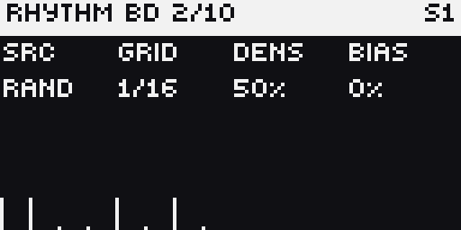
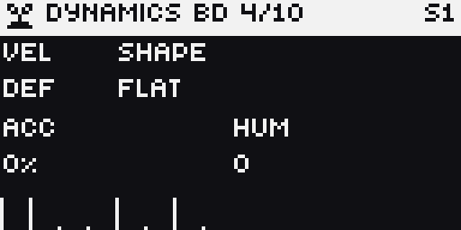
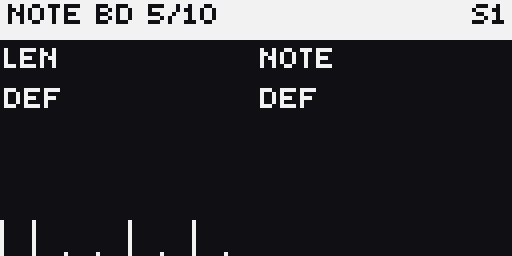
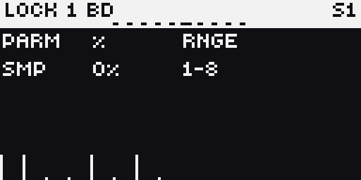
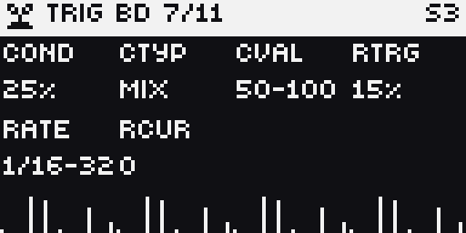
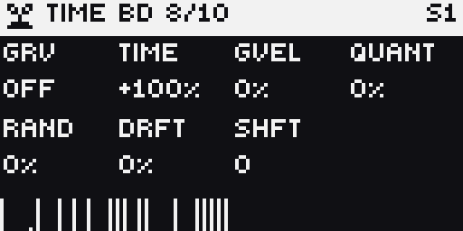
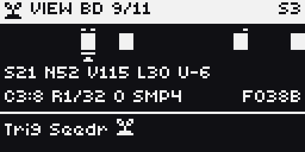
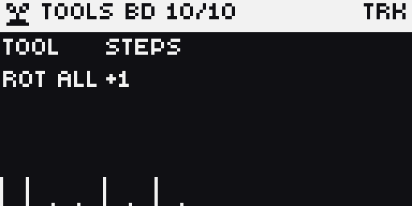

# trig-seedr

[](LICENSE)
[](https://github.com/a1o1/trig-seedr/releases)
[](#status)
[](docs/firmware-notes-os174.md)
[](docs/firmware-notes-st142.md)
[](https://github.com/elekloader/elekloader)
[](lib/)
[](tools/README.md)
[](https://github.com/trigcondition/analog-emu)
[](docs/flashing.md#tested-on-hardware)
[](https://a1o1.github.io/trig-seedr/getting-started/build/#your-own-grooves)
[](https://www.anthropic.com/claude)
[](https://a1o1.github.io/trig-seedr/)
[](https://conventionalcommits.org)

**The manual and website: [a1o1.github.io/trig-seedr](https://a1o1.github.io/trig-seedr/)**: a quick start, every page and knob, flashing and going back to stock, the beta, and how it is tested.

Pattern seeds for Elektron machines. trig-seedr adds pages to the machine's own screen that make and shape a track's
trigs, as an [elekloader](https://github.com/elekloader/elekloader) mod:

| Device | OS | Status | Build | Flash |
|---|---|---|---|---|
| Analog Rytm MKII | 1.74 | beta; hardware-tested 0.5.1, 0.6.0, 0.7.1, 0.9.0 | `sh tools/build_release.sh` | [docs/flashing.md](docs/flashing.md) |
| Syntakt | 1.42 | ready for testing (beta); hardware-tested 0.7.1, 0.9.0 on one unit | `sh tools/build_release_st.sh` | [docs/flashing-st.md](docs/flashing-st.md) |

The Analog Four MKII and Digitone II are planned ([adding a device](docs/adding-a-device.md)). Each track has a recipe: a source of trigs
(the track's own, random with roles, Euclidean, a map of drum patterns, or another track's), then pages that place
them and set velocity and accents, notes, two lanes of parameter locks, trig conditions, retrigs and micro timing
from a groove. YES writes a take so you hear it, FUNC + YES keeps it, NO puts your original back. Everything written
is ordinary pattern data: it plays, saves and reloads on a stock OS. What differs between devices:
[Devices](https://a1o1.github.io/trig-seedr/devices/overview/).

<a id="status"></a>**Status: 0.9 is a beta;** 0.9.0 adds TURING, a Turing machine for a track. Version 1's design is built, but not final: beta feedback decides what changes before 1.0. Every release passes the full set of
checks in an emulator (analog-emu) on each device; 0.5.1, 0.6.0, 0.7.1 and 0.9.0 also passed tests on an Analog Rytm MKII
with OS 1.74 ([Tested on hardware](docs/flashing.md#tested-on-hardware)), and 0.7.1 and 0.9.0 passed hardware passes on a
Syntakt with OS 1.42 ([Tested on hardware](docs/flashing-st.md#tested-on-hardware)). Use it on projects you
have backed up, keep the stock OS and a DIN MIDI interface at hand to go back, and tell us what you find: [what beta
means](https://a1o1.github.io/trig-seedr/beta/beta/), [feedback](https://a1o1.github.io/trig-seedr/beta/feedback/).
Flashing modified firmware is at your own risk.

trig-seedr is an independent project. It is not affiliated with or endorsed by Elektron or Ableton; their product names are used only to say what it works with. No firmware, and nothing derived from Ableton's content, is included: you build against your own copy of the stock OS, and generate groove tables from your own Live installation.

## The pages

It is a third page behind the **TRIG** key: **TRIG**, **TRIG** (EUCLIDEAN), **TRIG** (trig-seedr); **TRIG held +
PAGE** opens it from anywhere, and **LEFT / RIGHT** step through its pages. Start with the
[Quick start](https://a1o1.github.io/trig-seedr/getting-started/quick-start/); every page is in the
[manual](https://a1o1.github.io/trig-seedr/manual/concepts/).

Screens, from the emulator:

<table>
<tr><td align="center"><br>TAKE</td><td align="center"><br>RHYTHM</td></tr>
<tr><td align="center"><br>PLACE</td><td align="center"><br>DYNAMICS</td></tr>
<tr><td align="center"><br>NOTE</td><td align="center"><br>LOCK</td></tr>
<tr><td align="center"><br>TRIG</td><td align="center"><br>TIME</td></tr>
<tr><td align="center"><br>VIEW</td><td align="center"><br>TOOLS</td></tr>
</table>

## Build and flash

Development and releases are on a Mac. Next to this repository (or set `WORKSPACE`): `elekloader/`
([elekloader/elekloader](https://github.com/elekloader/elekloader)), `analog-emu/`
([trigcondition/analog-emu](https://github.com/trigcondition/analog-emu)), the stock OS in
`Official Firmwares/Analog-Rytm_MKII_OS1.74_dist/Analog-Rytm_MKII_OS1.74.syx` (or set `STOCK`), and an m68k-elf cross
compiler (`ELEKLOADER_CROSS=m68k-elf-`).

```sh
sh tools/doctor.sh                        # the environment
make -C lib test coldfire                 # the engine: host tests (sanitizers) and a ColdFire build check
sh tools/run_tests.sh                     # every check: host, then the emulator (NAME... for some)
sh tools/build_release.sh                 # the firmware to flash: build/trig-seedr-0.9.0-os1.74.syx
```

For the Syntakt: the stock OS in `Official Firmwares/Syntakt OS 1.42/Syntakt OS/Syntakt_OS1.42.syx` (or set
`STOCK_ST`), `analog-emu-st/`, `external/synfact-dev/` and `external/elektron-firmware-tool/`; then
`sh tools/st_run_tests.sh` and `sh tools/build_release_st.sh`
([Building: the Syntakt](https://a1o1.github.io/trig-seedr/getting-started/build/#the-syntakt)).

Everything under `build/` contains Elektron's firmware: keep it to yourself. Flash with Elektron Transfer as an OS
update, then run the first checks: [`docs/flashing.md`](docs/flashing.md) for the Rytm,
[`docs/flashing-st.md`](docs/flashing-st.md) for the Syntakt; each also says how to go back to stock.
More: [Building](https://a1o1.github.io/trig-seedr/getting-started/build/) (and your own grooves from Ableton Live),
[the emulator](https://a1o1.github.io/trig-seedr/getting-started/emulator/),
[`docs/dev-environment.md`](docs/dev-environment.md), [how it is tested](docs/testing.md).

## Links

| What | Where |
|---|---|
| The manual | [a1o1.github.io/trig-seedr](https://a1o1.github.io/trig-seedr/) |
| Release notes | [`docs/release-0.7.md`](docs/release-0.7.md), [0.6](docs/release-0.6.md), [0.5](docs/release-0.5.md), [0.4](docs/release-0.4.md) |
| Flashing, first checks, back to stock | [`docs/flashing.md`](docs/flashing.md) |
| How it is tested | [`docs/testing.md`](docs/testing.md), [`tools/README.md`](tools/README.md) |
| Requirements, design and plan | [`docs/requirements.md`](docs/requirements.md), [`docs/design-v1.md`](docs/design-v1.md), [`docs/plan-v1.md`](docs/plan-v1.md) |
| Firmware notes | [`docs/firmware-notes-os174.md`](docs/firmware-notes-os174.md) |
| Issues: hardware reports, bugs, ideas | [github.com/a1o1/trig-seedr/issues](https://github.com/a1o1/trig-seedr/issues) |

## Layout

| Path | What |
|---|---|
| `lib/` | the engine: `seed.h` (the contract), `seed_render.c` (the chain), `seed_rng.c` (seeds, keys, VARY) and a module per layer; portable C99 with no device code and no C library; host tests |
| `device/` | the device layers: the Rytm's OS 1.74 (`rytm_ar2.h`: capabilities, read any track, write with whole-step moves through the stock step and lock routines, the lock-row check, snapshot / restore) and the Syntakt's OS 1.42 (`syntakt_st.h`; `st_params.h` is made from your own stock file by `tools/st_params.sh`, never committed); their host tests |
| `frame/` | the mod's device-neutral part (`frame.c`: keys, audition, drawing; `pages.c`: every page's knobs; the preview and VIEW), shared by each device's mod |
| `mods/seedr-ar2/` | the elekloader mod for the Analog Rytm MKII (`seedr.c`: the Rytm's side of `frame/frame.h`; `mod.json`) and its groove tables |
| `mods/seedr-st/` | the mod for the Syntakt (`seedr.c`: the Syntakt's side of `frame/frame.h`); `docs/plan-syntakt.md` |
| `tools/` | the test harness (`run_tests.sh`, `tests/`, `emu.sh`, `seedref.c`), the release build, the screenshots (`screens.sh`), groove conversion (`groove2h.py`), firmware study scripts |
| `docs/` | requirements, the version 1 design and plan, flashing, testing, release notes, task status (`status/`), the development environment and firmware notes |
| `site/` | the website and manual (Astro Starlight): the manual's pages are in `site/src/content/docs/` |

## Acknowledgements

trig-seedr builds on elekloader, analog-emu and other open source projects, and on published research (Clarence
Barlow's indispensability, George Sioros and Carlos Guedes' syncopation transformations). The MAP source's map of
drum patterns is that of Grids by Emilie Gillet, from [Mutable Instruments' Eurorack modules](https://github.com/pichenettes/eurorack)
(GPL-3.0-or-later). The full list, with what each was used for:
[Acknowledgements](https://a1o1.github.io/trig-seedr/about/acknowledgements/).

## Contributing

Commit messages follow Conventional Commits; scopes, checks and the commit hook: [`CONTRIBUTING.md`](CONTRIBUTING.md).

## License

GPL-2.0-or-later (see `LICENSE`), as elekloader.

`lib/map_data.c`, the MAP source's data, is GPL-3.0-or-later, as the project it comes from. A build that includes
it, as the mod does (`mods/seedr-ar2/mod.json`), is therefore GPL-3.0-or-later (see `LICENSES/GPL-3.0-or-later.txt`);
the rest of the repository stays GPL-2.0-or-later.
