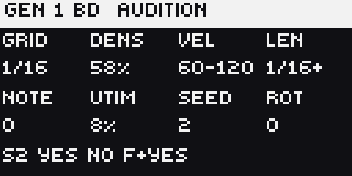
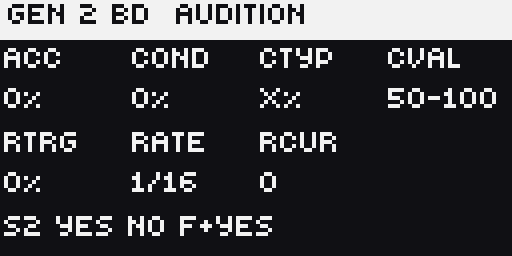
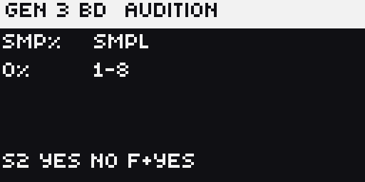
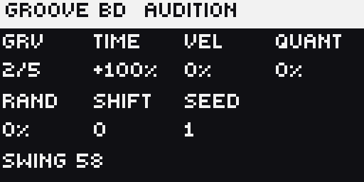
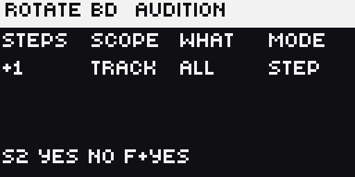

# trig-seedr

[](LICENSE)
[](https://github.com/a1o1/trig-seedr/releases)
[](#status)
[](docs/firmware-notes-os174.md)
[](https://github.com/elekloader/elekloader)
[](lib/)
[](tools/README.md)
[](https://github.com/trigcondition/analog-emu)
[](#grooves)
[](https://www.anthropic.com/claude)
[](https://conventionalcommits.org)

Offline pattern algorithms for the Analog Rytm MKII (OS 1.74), as an [elekloader](https://github.com/elekloader/elekloader) mod: a generator with an audition undo, Ableton grooves for micro timing and velocity, sample locks per trig, and rotation of a track or the whole pattern.

<a id="status"></a>**Status: works in the emulator (analog-emu, 33 scripted checks), not yet run on a unit.** Flashing modified firmware is at your own risk; keep the stock OS and a way to reflash it (DIN MIDI) at hand.

trig-seedr is an independent project. It is not affiliated with or endorsed by Elektron or Ableton; their product names are used only to say what it works with. No firmware, and nothing derived from Ableton's content, is included: you build against your own copy of the stock OS, and generate groove tables from your own Live installation.

## What it does

Hold **TRIG** and press **PAGE** to open it on the current track; **PAGE** steps through its pages:

| Page | What |
|---|---|
| VIEW | the track's steps and the fields of the step under the cursor (read only) |
| GEN 1 | rhythm and notes: GRID, DENS, VEL, LEN, NOTE, UTIM (random micro timing), SEED, ROT |
| GEN 2 | accents, trig conditions (X%, A:B, 1ST, FILL, mixed), retrigs (share, rate, velocity curve) |
| GEN 3 | sample-slot locks: SMP% of the trigs get a slot from the SMPL range |
| GROOVE | a groove's micro timing and velocity on the track's trigs: TIME, VEL, QUANT, RAND, SHIFT |
| ROTATE | moves whole steps (with their locks) or one field, on this track or every track |

Screens, from the emulator (a generated BD take being auditioned):

| | |
|---|---|
|  VIEW |  GEN 1 |
|  GEN 2 |  GEN 3 |
|  GROOVE |  ROTATE |

- **YES** applies. The first YES snapshots the track (or tracks); each YES after it starts again from that original, so you audition takes. YES with no knob turned since the last YES moves to the next seed.
- **NO** goes back to the original; **FUNC + YES** keeps the take. Leaving the page, the track or the pattern keeps it too.
- Ranges (VEL, LEN, NOTE, RATE, SMPL): a knob sets the high end, **FUNC** + knob the low end.
- Everything written is ordinary Rytm data: it plays, saves and reloads on a stock OS.

Details: [`docs/requirements.md`](docs/requirements.md). Firmware notes: [`docs/firmware-notes-os174.md`](docs/firmware-notes-os174.md).

## Layout

| Path | What |
|---|---|
| `lib/` | the algorithms (`gen.c`: GENERATOR, ROTATE; `groove.c`: GROOVE), portable C with no device code and no C library; host tests |
| `device/rytm_ar2.h` | the OS 1.74 device layer: read a track, write it through the stock step and lock routines, snapshot / restore |
| `mods/seedr-ar2/` | the elekloader mod (`seedr.c`, `mod.json`) and its groove tables |
| `tools/` | groove conversion (`groove2h.py`), emulator test (`test_seedr.sh`) and helpers, firmware study scripts |
| `docs/` | requirements and firmware notes |

## Building and testing

Expected next to this repository (or set `WORKSPACE`):

- `elekloader/` ([elekloader/elekloader](https://github.com/elekloader/elekloader)) — the mod loader and the Rytm core (core-ar2 0.13).
- `analog-emu/` ([trigcondition/analog-emu](https://github.com/trigcondition/analog-emu)) — the whole-device emulator, built (`cargo build --release`).
- `Official Firmwares/Analog-Rytm_MKII_OS1.74_dist/Analog-Rytm_MKII_OS1.74.syx` — the stock OS from Elektron (or set `STOCK`).
- An m68k-elf cross compiler (binutils + gcc, C only), `ELEKLOADER_CROSS=m68k-elf-`.

```sh
make -C lib test coldfire                 # host tests (sanitizers) and a ColdFire build check
python3 tools/test_groove2h.py PATH/TO/Live/Core\ Library/Grooves   # the .agr / MIDI reader
sh tools/test_seedr.sh                    # build, patch the OS, run the emulator checks (PART=1..6: one part)
```

`test_seedr.sh` writes `build/seedr.syx` (the patched OS). It contains Elektron's firmware: keep it to yourself.

To try it by hand, in the emulator's window:

```sh
cd ../analog-emu
./target/release/dtcard play.img format
./target/release/rytm ../trig-seedr/build/seedr.syx --card play.img --snapshot play.snap
```

A new card first shows FILE SYSTEM OK; close it with NO. Delete the `.snap` after a rebuild.

## Grooves

`mods/seedr-ar2/grooves-swing.h` (MPC-style swing amounts) is used unless `grooves-live.h` exists. Make that one from your own Live installation (plain-XML `.agr` files; protected ones are skipped) or from MIDI files exported from Live:

```sh
python3 tools/groove2h.py "/Applications/Ableton Live 11 Suite.app/Contents/App-Resources/Core Library/Grooves/Swing/MPC" \
    MORE_FOLDERS_OR_FILES.mid > mods/seedr-ar2/grooves-live.h
```

`grooves-live.h` is in `.gitignore`: it is derived from Ableton's files.

## Acknowledgements

trig-seedr builds on, and learned from, these open source projects:

| Project | License | How it was used |
|---|---|---|
| [elekloader](https://github.com/elekloader/elekloader) | GPL-2.0 | the mod loader, the Rytm core (core-ar2) the mod runs on, and its build and patch tools; its notes on the OS's tracks, patterns and lock store |
| [analog-emu](https://github.com/trigcondition/analog-emu) | MIT | the whole-device emulator every test runs in (headless `dtboot`, the windowed `rytm`, `dtcard` for sample cards) |
| [sidecar-mods](https://github.com/trigcondition/sidecar-mods) | GPL-2.0 | reverse-engineering notes (`re/symbols.toml`): the parameter-lock routines and tables, sample-slot and live-record paths; `tools/presses.py` follows its `pj_emu.py` |
| [sidecar-expander](https://github.com/trigcondition/sidecar-expander), [sidecar-firmware](https://github.com/trigcondition/sidecar-firmware) | GPL-2.0 | background on extending the Rytm and its documentation |
| [libanalogrytm](https://github.com/bsp2/libanalogrytm) | MIT | the pattern format: step fields, flag bits, the note-length scale, trig conditions |
| [rytm-rs](https://github.com/alisomay/rytm-rs) | MIT | micro-timing values and encodings |
| [Synthack-OS](https://github.com/karigardarsson/Synthack-OS) | MIT | Syntakt firmware modding (SyntHack, Syntakt MAX), for the later Syntakt port |
| [syntakt-firmware-workbench](https://github.com/Bezronczek/syntakt-firmware-workbench) | MIT | Syntakt firmware tooling, for the later Syntakt port |
| [digikit](https://github.com/ElekLabs/digikit) | AGPL-3.0 | Digitakt II / Digitone II firmware research |
| [modwerk](https://github.com/repeat98/modwerk) | mixed (Elastic-2.0 and others) | firmware modding research |
| [Capstone](https://www.capstone-engine.org/), [Unicorn](https://www.unicorn-engine.org/) | BSD-3 / GPL-2.0 | disassembly and function-level emulation in `tools/` |

No code from the projects under other licences is included; each is credited for what it documented or made possible.

## Contributing

Commit messages follow Conventional Commits; scopes, checks and the commit hook: [`CONTRIBUTING.md`](CONTRIBUTING.md).

## License

GPL-2.0-or-later (see `LICENSE`), as elekloader.
