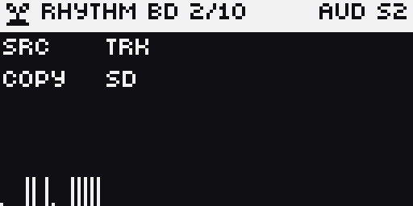
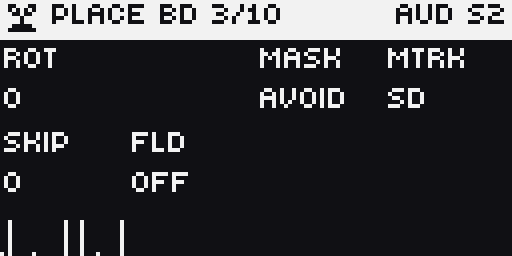

# RHYTHM: COPY and PLACE: MASK

Two ways to make a track's rhythm from another track of the pattern: COPY takes its trig positions, MASK removes
trigs where it plays (AVOID) or where it does not (ONLY).

## COPY

SRC = COPY is one of the RHYTHM page's sources, next to TRACK, RAND, EUCLID and MAP.

| Knob | Range | Default | Does |
|---|---|---|---|
| A SRC | | | COPY |
| B TRK | the pattern's tracks (BD .. FX) | BD | the track whose trig positions are taken |

Step i gets a trig when TRK has a trig on step i. Only the positions are taken: each new trig starts with the track's
defaults, as with RAND and EUCLID, and the later layers (DYNAMICS, NOTE, LOCK, TRIG, TIME) fill its fields. TRK's
velocities, notes, locks and conditions are not copied.

- **Lengths.** A TRK shorter than the track repeats, as it does when the pattern plays (a 12-step TRK on a 16-step
  track gives its 12 steps and then its first 4 again). A longer TRK gives its first steps.
- **TRK = the track itself** gives the track's own trig positions with every field back at its default: a way to
  start again on the same rhythm.
- **Trigs as stored.** A muted trig counts. A track in stock's Euclidean mode gives the trigs stored in it, not the
  pattern Euclidean mode plays.
- COPY uses no random numbers: the seed and VARY change only the later layers.

## MASK

| Knob | Range | Default | Does |
|---|---|---|---|
| C MASK | OFF, AVOID, ONLY | OFF | AVOID: remove trigs where MTRK has a trig; ONLY: remove trigs where MTRK has none |
| D MTRK | the pattern's tracks | BD | the track the mask follows (shown when MASK is not OFF) |

MASK works with every source, SOURCE = TRACK included. It runs after ROT and SYNC and before SKIP, so it holds on the
trigs' final positions: with AVOID, no trig of the result sits on a step where MTRK has a trig, whatever ROT does.

- **It only removes.** A trig MASK keeps is unchanged. A trig it removes is cleared as SKIP clears it: no trig, the
  step's fields and locks back to the defaults. Steps without a trig are not touched.
- **AVOID and ONLY split the track:** with the same recipe, the trigs AVOID keeps and those ONLY keeps are the
  unmasked trigs, each once.
- **Lengths** as COPY: a shorter MTRK repeats, a longer one gives its first steps. A track that is not in the
  pattern has no trigs (AVOID keeps everything, ONLY nothing).
- **MTRK = the track itself** masks against the track's original trigs, for instance ROT with ONLY keeps the rotated
  trigs that land where the track already had one.

Examples on a 16-step track, MTRK = `x...x...x...x...`:

| Before MASK | AVOID | ONLY |
|---|---|---|
| `x.x.x.x.xxxx....` | `..x...x..xxx....` | `x...x...x.......` |

## The preview and other tracks

COPY and MASK read the other track as it is stored now. The preview strip follows it: change TRK or MTRK with
stock's keys (TRK + a TRIG key to select it, record, TRK + a TRIG key back) and the strip shows the new take before
YES. A take already written does not change when the other track changes later; YES renders it again.
