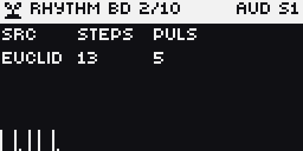

# RHYTHM: EUCLID

SRC = EUCLID spreads a number of pulses as evenly as they go over a cycle of steps. It is one of the RHYTHM page's
sources, next to TRACK, RAND, MAP and COPY.

| Knob | Range | Default | Does |
|---|---|---|---|
| A SRC | | | EUCLID |
| B STEPS | 1..64 | 16 | the cycle's length in steps |
| C PULS | 0..64 | 4 | pulses in each cycle; above STEPS, every step has a trig |

## The pattern

The pattern is the one the Rytm's own Euclidean mode plays (TRIG, TRIG: the EUCLIDEAN page) with LEN = STEPS,
PL1 = PULS, PL2 at 0 and no rotation. The first step of the cycle always has a pulse, and the gaps between pulses
differ by at most one step. Examples:

| STEPS | PULS | Pattern |
|---|---|---|
| 16 | 4 | `x...x...x...x...` |
| 16 | 5 | `x...x..x..x..x..` |
| 16 | 7 | `x..x.x.x..x.x.x.` |
| 8 | 3 | `x..x..x.` |
| 13 | 5 | `x..x..x.x..x.` |

A track longer than STEPS repeats the cycle (STEPS 12 on a 64-step track plays the cycle five times and then its
first four steps); a track shorter than STEPS plays the start of the cycle. With STEPS equal to the track's length the
result is the same as stock's Euclidean mode on that track.

## With the other layers

EUCLID only places trigs. Every later layer works on them as on any other source: PLACE ROT rotates the pattern,
SYNC, MASK and SKIP move or remove trigs, and DYNAMICS, NOTE, LOCK, TRIG and TIME fill the trigs' fields. Each generated step starts with the track's defaults, as with RAND.

EUCLID uses no random numbers: the seed and VARY do not change the rhythm, only the layers after it that draw
random values (velocity ranges, conditions, locks and so on).

## Differences from stock's Euclidean mode

- trig-seedr writes ordinary trigs into the pattern. The track is not in Euclidean mode, and the trigs can be edited
  by hand afterwards.
- Stock's second generator (PL2, RO2) and the operator (OP) are not part of EUCLID.
- STEPS is independent of the track's length; stock's LEN is the track's length.
- trig-seedr refuses to write to a track that is in Euclidean mode ("EUCLID IS ON: TURN IT OFF"); turn EUC off on
  the EUCLIDEAN page first.
