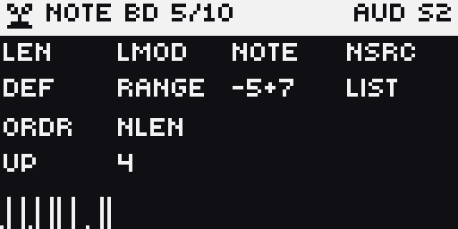
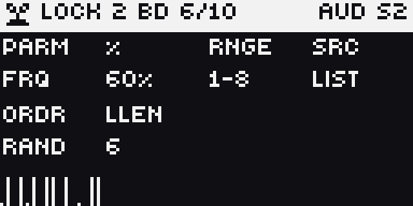

# Value lists and LEGATO

A value list gives the trigs a short sequence of values in a fixed order, the way an arpeggiator walks its notes,
in place of a fresh random value on every trig. LIST is a value source next to RANGE (and NOISE, F7): NOTE and both
LOCK lanes offer it on their pages. LEGATO is a length mode: each trig lasts until the next trig.

## NOTE and LOCK: LIST

| Page | Knob | Values | Meaning |
|---|---|---|---|
| NOTE | NSRC | RANGE, LIST, NOISE | where the notes come from |
| NOTE | ORDR | UP, DOWN, PING, PNG2, ODD, RAND | the order the trigs walk the list in (NSRC = LIST) |
| NOTE | NLEN | 1..16 | the list's length (NSRC = LIST) |
| LOCK | SRC, ORDR, LLEN | as NSRC, ORDR, NLEN | the same for the lane in view (UP / DOWN: lane 1, 2) |

ORDR and NLEN (LLEN) are shown only when the source is LIST. NOTE (or the lane's RNGE) still sets the range the
list's values come from; with NOTE at DEF the notes are left as they are, whatever the source.

**The list.** NLEN values are drawn from the range, then sorted from low to high. The seed decides the values; VARY
keeps or re-rolls each one on its own, so with VARY above 0 the next take changes only some of them.

**The order.** The trigs take the list's values one after another, from the track's first trig to its last; at the
end of the list it starts again. With the sorted list numbered 1 to N:

| ORDR | Trigs get (N = 4) | Repeats every |
|---|---|---|
| UP | 1 2 3 4 1 2 3 4 … | N trigs |
| DOWN | 4 3 2 1 4 3 2 1 … | N trigs |
| PING | 1 2 3 4 3 2 1 2 … (the ends once) | 2N − 2 trigs |
| PNG2 | 1 2 3 4 4 3 2 1 1 … (the ends twice) | 2N trigs |
| ODD | 1 3 2 4 1 3 … (odd places, then even; N = 5: 1 3 5 2 4) | N trigs |
| RAND | a value from the list at random on each trig | |

A list of length 1 gives every trig the same value. A range narrower than the list gives repeated values.

**On a LOCK lane** the lane's % still picks which trigs get a lock. The list position counts every trig, locked or
not, so raising % adds locks without changing the values already there.

## NOTE: LMOD = LEGATO

| Knob | Values | Meaning |
|---|---|---|
| LMOD | RANGE, LEGATO | RANGE: LEN sets the lengths. LEGATO: each trig lasts until the next trig |

With LEGATO each trig gets the shortest of the Rytm's length values that reaches the next trig: 1 step is 1/16,
2 steps 1/8, 4 steps 1/4. The last trig reaches the first one, a loop later; a lone trig lasts the whole track. A
gap of an odd number of steps above 32 has no exact length value and gets the next one up (33 steps: 34). Micro
timing is not taken into account. LEGATO runs after PLACE, so it measures the gaps where the trigs end up, and LEN
is not used while it is on.

## Other fields

VEL, CVAL and RATE take the same sources in the engine (design V9), but their pages show only a range in version 1.

 
