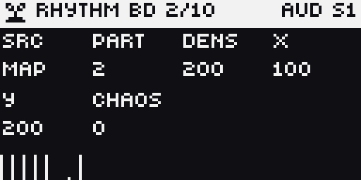
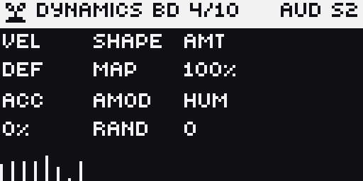

# RHYTHM: MAP

SRC = MAP takes a rhythm from a map of drum patterns. It is one of the RHYTHM page's sources, next to TRACK, RAND,
EUCLID and COPY. The map comes from an open source drum sequencer, credited in the README's acknowledgements.

| Knob | Range | Default | Does | Kept by |
|---|---|---|---|---|
| A SRC | | | MAP | the track |
| B PART | 1..3 | 1 | which of the map's three parts: 1 is written for kick drums, 2 for snares, 3 for hats | the track |
| C DENS | 0..255 | 128 | how many steps fire: 0 none, 255 every step the part plays at all | the track |
| D X | 0..255 | 128 | the place on the map, across | the pattern |
| E Y | 0..255 | 128 | the place on the map, down | the pattern |
| F CHAOS | 0..255 | 0 | a random lift of the levels, drawn from the seed | the pattern |

X, Y and CHAOS are shared by the pattern's tracks: turning X on BD's page turns it for SD too. PART and DENS belong to
each track, so BD on part 1, SD on part 2 and a hat on part 3 at the same X and Y make a kit from one place on the
map; DENS then thins or fills each one.

## The map

The map is a grid of 5 × 5 patterns of 32 steps, each with three parts. In each pattern every step of a part has a
level from 0 to 255: how strongly that step belongs to the rhythm. X and Y move across the grid; between the
patterns the four nearest ones are blended, so turning X or Y changes the rhythm gradually.

A step fires when its level is above 255 − DENS. Raising DENS only adds steps, starting with the strongest; lowering
it removes the weakest first. A track longer than 32 steps repeats the 32 (a 64-step track plays them twice); a
shorter track plays their start.

## CHAOS

CHAOS lifts every level of a part by a random amount, the same over each 32 steps, up to CHAOS / 4 (62 at CHAOS
255). A lifted step can fire at a DENS where it did not before, so CHAOS adds steps near the threshold. The lift
comes from the seed: YES with no knob turned takes the next seed and a new lift, and on a 64-step track each half
gets its own. With TAKE's VARY, takes keep their lift with VARY's share, as every other random choice does.

With CHAOS below 4 there is no lift, and the seed does not change the rhythm; it changes only the later layers that
draw random values. The title bar shows the seed (S1) either way.

## SHAPE = MAP

On DYNAMICS, SHAPE = MAP sets each trig's velocity from its level at the same X, Y and the track's PART: level 0 is
VEL's low end, 255 its high end (with VEL = DEF, half the trig's velocity to the trig's velocity). AMT mixes it with
VEL as for every shape. It works with any source, so the map's levels can shape a rhythm from RAND, EUCLID or the
track's own trigs.

## Differences from the original sequencer

- trig-seedr writes ordinary trigs into the pattern; the result can be edited by hand afterwards. The map is read
  once per YES, not as the pattern plays.
- The original's accent outputs (steps whose level is above 192) are not written as accents. SHAPE = MAP makes those
  steps the loudest; DYNAMICS' ACC sets the accent flag on its own terms.
- The original's swing and its Euclidean mode are not part of MAP (TIME's grooves and SRC = EUCLID cover them).
